# Laporan Latihan Kelompok 7 Pertemuan 9

## Anggota dan Kontribusi
Nama                 |    NIM    | Kontribusi                                   | Commit 
---------------------+-----------+----------------------------------------------+-------------------
Andika Chairul Ilham | 251402047 | Langkah 3 (Q14 - Q17), Langkah 4 (Q18 - Q21) | Commit 
Fahri Arizal         | 251402102 | Langkah 2 (Q6 - Q11), Langkah 3 (Q12 - Q13)  | Commit 
Fitya Shofi Ahmad    | 251402132 | Langkah 1, Langkah 6                         | Commit 
Mar'ie Rizqullah     | 251402129 | Langkah 4 (Q22 - Q29), Langkah 5             | Commit 

## Konfigurasi relevan (hasil perintah SHOW)
Parameter                           | Nilai 
------------------------------------+-----------------
transaction_isolation               | read committed
deadlock_timeout                    | 1s
lock_timeout                        | 0
statement_timeout                   | 0
idle_in_transaction_session_timeout | 0

## Data Awal
1. Hasil dari SELECT * FROM lab9.rekening ORDER BY rekening_id;

rekening_id | pemilik | saldo 
------------+---------+------------
          1 | Ani     | 1000000.00     
          2 | Budi    | 1000000.00     

2. Total saldo awal: 2000000.00

## Jawaban Q1-Q32
1. Q1
-- Sesi A
SELECT * FROM lab9.rekening ORDER BY rekening_id;
SELECT SUM(saldo) AS total_saldo FROM lab9.rekening;

Hasil sebelum:
Tabel baru dibuat dan diisi oleh q00_setup.sql

Hasil sesudah:
rekening_id | pemilik | saldo
------------+---------+------------
          1 | Ani     | 1000000.00
          2 | Budi    | 1000000.00

total_saldo = 2000000.00

Status akhir: Tidak ada transaksi eksplisit
SQLSTATE (jika ada eror): -
Penjelasan penyebab:
Data awal terbukti dua rekening dengan saldo masing-masing 1.000.000, sehingga total saldo 2.000.000. Total ini dipakai sebagai patokan setiap transfer yang benar tidak boleh mengubah total sehingga bisa dipakai untuk memeriksa konsistensi di soal-soal berikutnya.

Bukti:
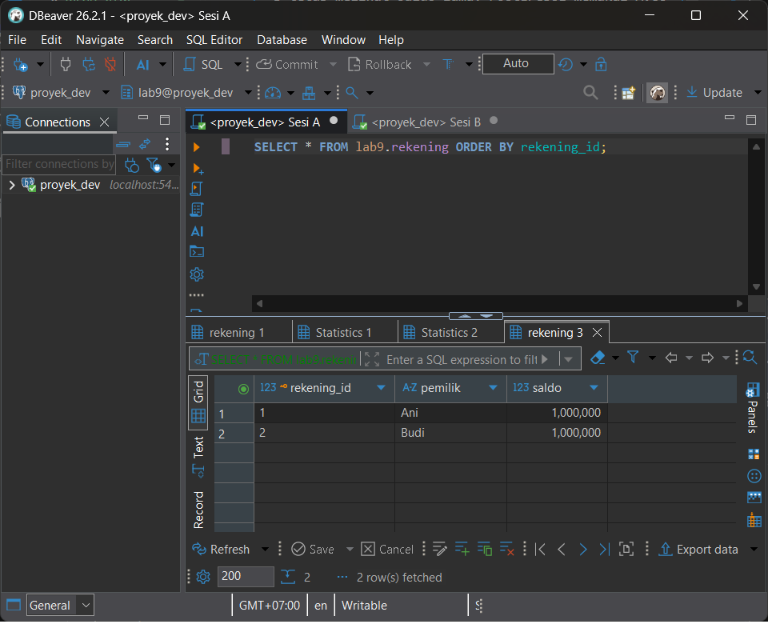
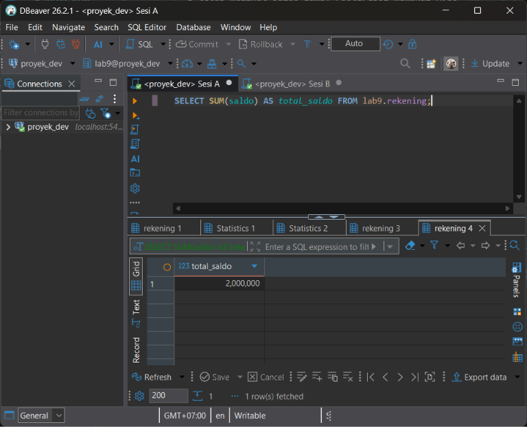

2. Q2
-- Sesi A
BEGIN;
UPDATE lab9.rekening SET saldo = saldo - 100000 WHERE rekening_id = 1;
UPDATE lab9.rekening SET saldo = saldo + 100000 WHERE rekening_id = 2;
SELECT * FROM lab9.rekening ORDER BY rekening_id;   -- belum COMMIT

-- Sesi B (saat sesi A belum COMMIT)
SELECT * FROM lab9.rekening ORDER BY rekening_id;

-- Sesi A
ROLLBACK;

Hasil sebelum:
Ani 1.000.000
Budi 1.000.000

Hasil sesudah:
Sesi                                   |     Ani    | Budi
---------------------------------------+------------+--------------
A (di dalam transaksi, sebelum COMMIT) | 900000.00  | 1100000.00
B (sesi lain)                          | 1000000.00 | 1000000.00

Status akhir: ROLLBACK (data kembali 1.000.000 / 1.000.000)
SQLSTATE (jika ada eror): -
Penjelasan penyebab:
Sesi A melihat perubahannya sendiri, sedangkan Sesi B tetap melihat saldo lama. PostgreSQL memakai MVCC dan hanya menampilkan data yang sudah di-COMMIT kepada sesi lain, sehingga perubahan yang belum di-COMMIT tidak bocor (tidak ada dirty read). Perubahan baru terligat oleh Sesi B jika Sesi A melakukan COMMIT.

Bukti:
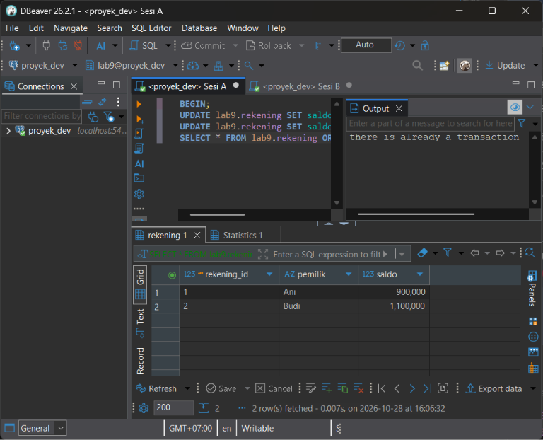
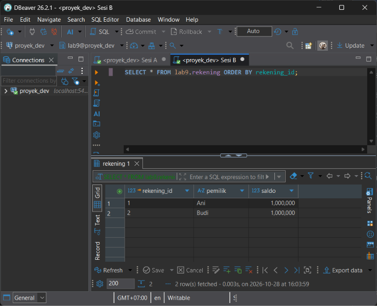

3. Q3
* **Percobaan 1: COMMIT*
-- Sesi A
BEGIN;
UPDATE lab9.rekening SET saldo = saldo - 100000 WHERE rekening_id = 1;
UPDATE lab9.rekening SET saldo = saldo + 100000 WHERE rekening_id = 2;
COMMIT;

-- Sesi B
SELECT * FROM lab9.rekening ORDER BY rekening_id;

* **Percobaan 2: ROLLBACK*
--Sesi A
BEGIN;
UPDATE lab9.rekening SET saldo = saldo - 200000 WHERE rekening_id = 1;
UPDATE lab9.rekening SET saldo = saldo + 200000 WHERE rekening_id = 2;
ROLLBACK;

--Sesi B
SELECT * FROM lab9.rekening ORDER BY rekening_id;

Hasil sebelum:
Ani 1.000.000
Budi 1.000.000

Hasil sesudah:
Percobaan                             |    Ani    |     Budi   | Total
--------------------------------------+-----------+------------+---------------
Setelah COMMIT (transfer 100000.00)   | 900000.00 | 1100000.00 | 2000000.00 
Setelah ROLLBACK (transfer 200000.00) | 900000.00 | 1100000.00 | 2000000.00

Status akhir: Percobaan 1 COMMIT, percobaan 2 ROLLBACK
SQLSTATE (jika ada eror): -
Penjelasan penyebab:
Perubahan yang bertahan hanya transfer 100000.00 yang di-COMMIT, dan langsung terlihat oleh Sesi B. Transfer 200000.00 yang di-ROLLBACK dibatalkan seluruhnya sehingga saldo tidak berubah dari hasil percobaan 1. COMMIT membuat perubahan permanen dan terlihat oleh sesi lain, sedangkan ROLLBACK membatalkan semua perubahan sejak BEGIN.

Bukti: 
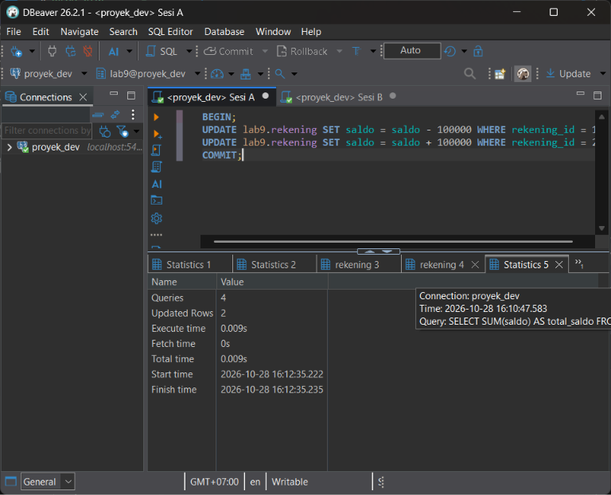
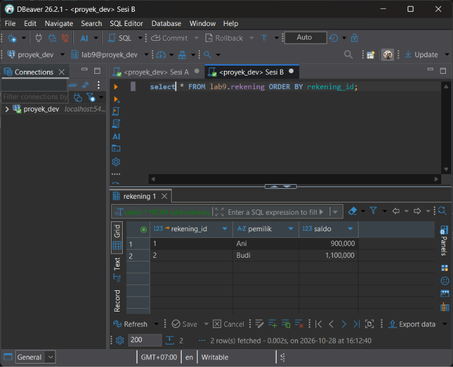
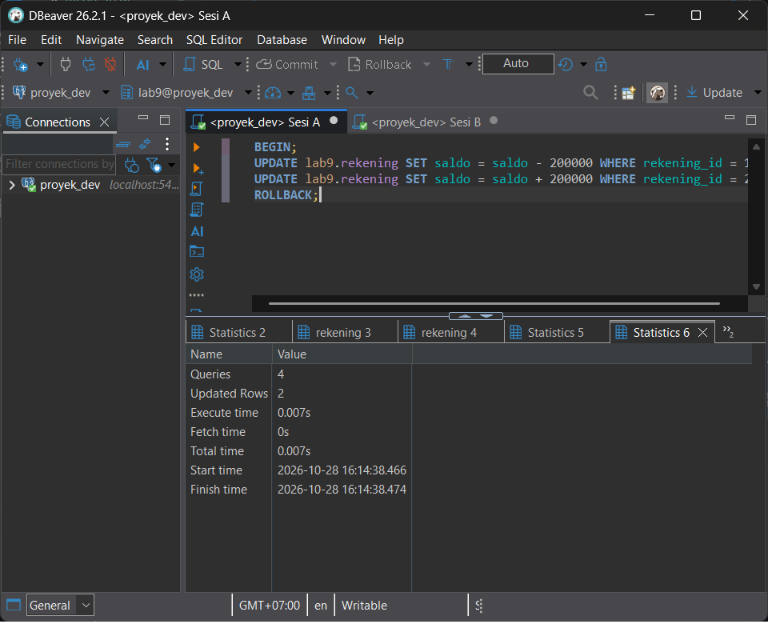
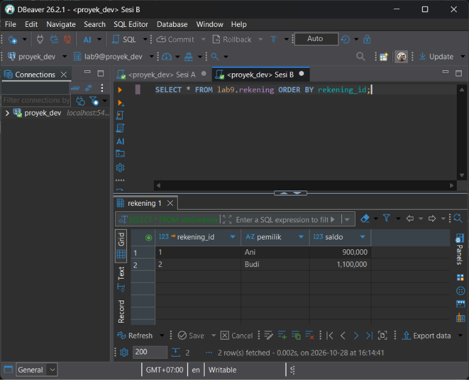

4. Q4
-- Sesi A
-- Sesi A
BEGIN;
UPDATE lab9.rekening SET saldo = saldo - 100000 WHERE rekening_id = 1;   -- transfer 1
UPDATE lab9.rekening SET saldo = saldo + 100000 WHERE rekening_id = 2;
SELECT * FROM lab9.rekening ORDER BY rekening_id;

SAVEPOINT sp1;

UPDATE lab9.rekening SET saldo = saldo - 200000 WHERE rekening_id = 1;   -- transfer 2
UPDATE lab9.rekening SET saldo = saldo + 200000 WHERE rekening_id = 2;
SELECT * FROM lab9.rekening ORDER BY rekening_id;

ROLLBACK TO SAVEPOINT sp1;
SELECT * FROM lab9.rekening ORDER BY rekening_id;

COMMIT;
SELECT * FROM lab9.rekening ORDER BY rekening_id;

-- Sesi B
....

Hasil sebelum:
Ani 1000000.00
Budi 1000000.00

Hasil sesudah:
Tahap                         |    Ani    | Budi
------------------------------+-----------+--------------
Setelah transfer 1            | 900000.00 | 1100000.00
Setelah transfer 2            | 700000.00 | 1300000.00
Setelah ROLLBACK TO SAVEPOINT | 900000.00 | 1100000.00
Setelah COMMIT                | 900000.00 | 1100000.00

Status akhir: ROLLBACK TO SAVEPOINT lalu COMMIT
SQLSTATE (jika ada eror): -
Penjelasan penyebab:
Yang dibatalkan hanya perubahan setelah SAVEPOINT sp1, yaitu transfer kedua (200000.00). Transfer pertama tetap ada dan ikut tersimpan saat COMMIT. ROLLBACK TO SAVEPOINT tidak mengakhiri transaksi, jadi transakssi tetap terbuka sampai COMMIT atau ROLLBACK. SAVEPOINT berguna untuk membatalkan sebagian langkah tanpa mengulang seluruh transaksi.

Bukti:
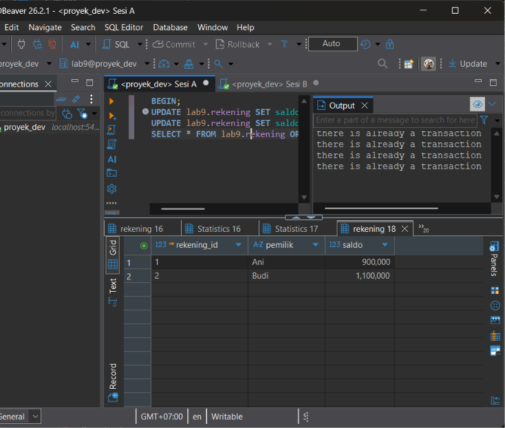
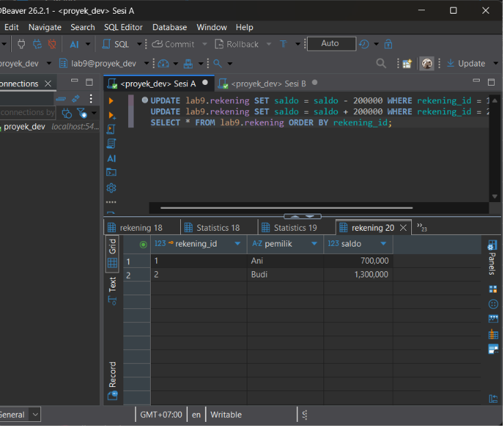
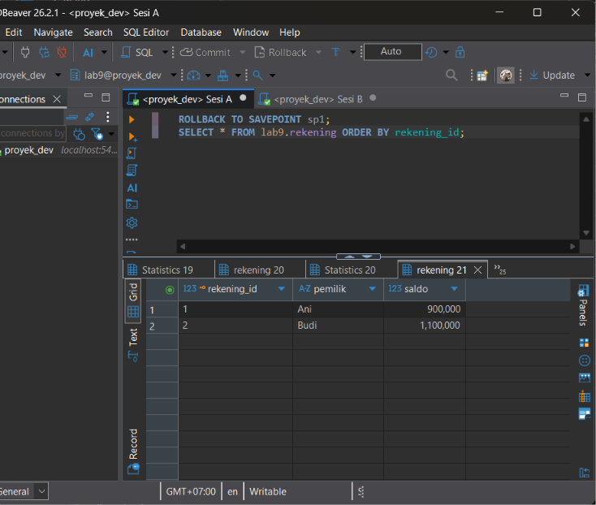
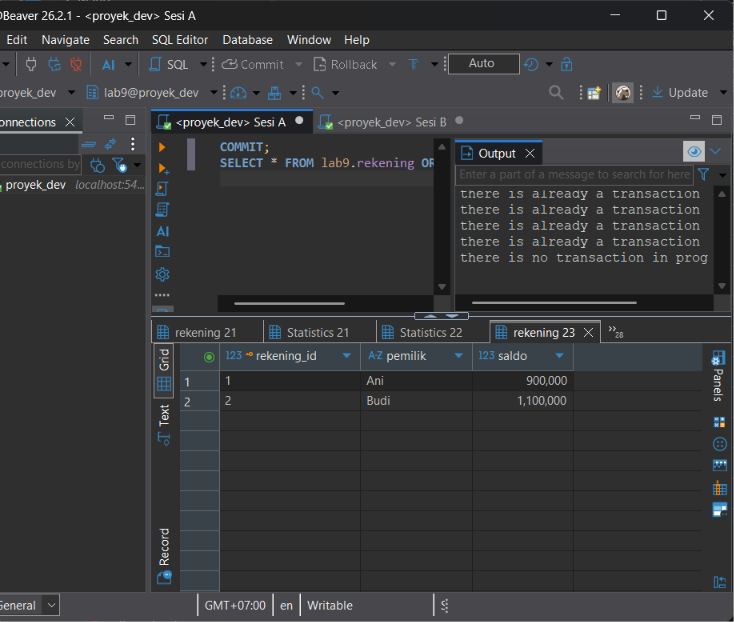

5. Q5
-- Sesi A
BEGIN;
UPDATE lab9.rekening SET saldo = saldo + 500000 WHERE rekening_id = 2;    -- berhasil
UPDATE lab9.rekening SET saldo = saldo - 5000000 WHERE rekening_id = 1;   -- melanggar CHECK
SELECT * FROM lab9.rekening;                                              -- ditolak (transaksi aborted)
ROLLBACK;
SELECT * FROM lab9.rekening ORDER BY rekening_id;

-- Sesi B
....

Hasil sebelum:
Ani 1000000.00
Budi 1000000.00

Hasil sesudah:
Langkah 2: Error occurred during SQL query execution
SQL Error [23514]: ERROR: new row for relation "rekening" violates check constraint "rekening_saldo_check"
  Detail: Failing row contains (1, Ani, -4000000.00).

Langkah 3: Error occurred during SQL query execution
SQL Error [25P02]: ERROR: current transaction is aborted, commands ignored until end of transaction block

Setelah ROLLBACK: Ani 1000000.00, Budi 1000000.00 (Total 2000000.00)

Status akhir: ROLLBACK 
SQLSTATE (jika ada eror): 23514(pelanggaran CHECK), 25P02(transaksi aborted)
Penjelasan penyebab:
* **Atomicity:* Penambahan saldo Budi sudah berhasil, tapi karena langkah berikutnya gagal ROLLBACK membatalkan keduanya. Transaksi berlaku semua atau tidak sama sekali.

* **Consistency:* CHECK (saldo >= 0) menolak data tidak valid (SQLSTATE 23514) sehingga database hanya berpindah dari satu keadaan vslid ke keadaan valid lain.

* Setelah error, transaksi berstatus aborted (25P02) dan hanya bisa diakhiri dengan ROLLBACK.

Bukti:
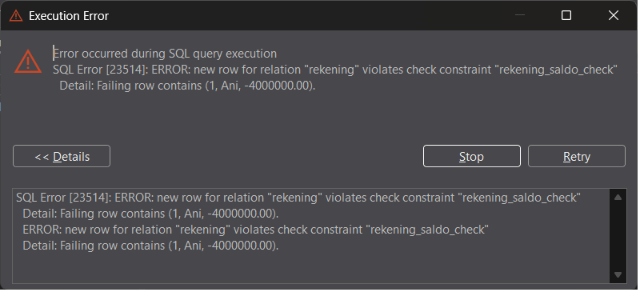
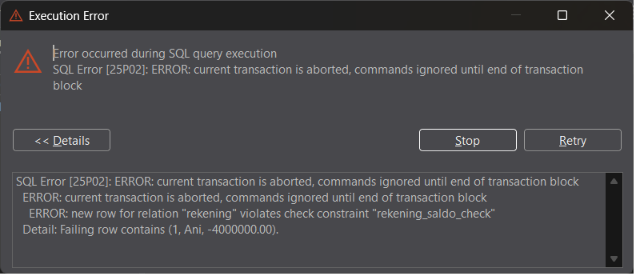
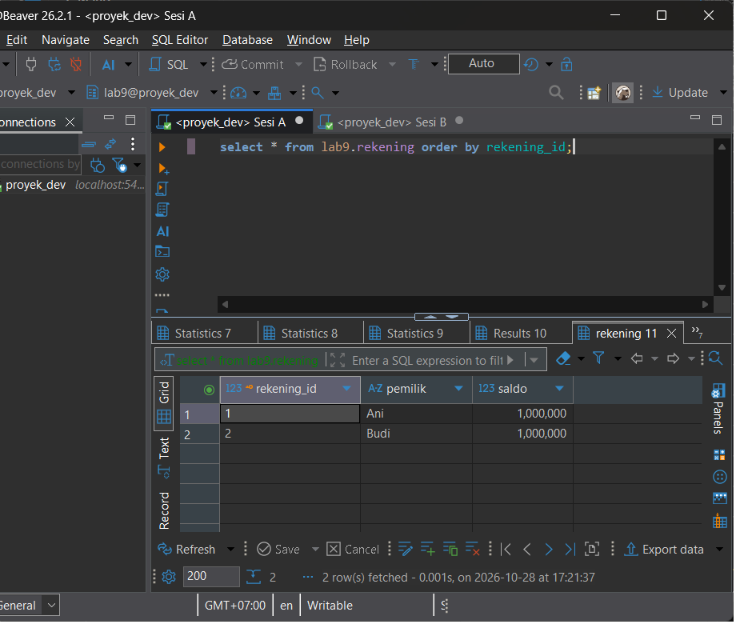

14. Q14
-- Sesi A
SELECT saldo, version_no FROM lab9.rekening_v WHERE rekening_id = 1;
UPDATE lab9.rekening_v SET saldo = 900000, version_no = version_no + 1
WHERE rekening_id = 1 AND version_no = 1;
-- Sesi B
SELECT saldo, version_no FROM lab9.rekening_v WHERE rekening_id = 1;
UPDATE lab9.rekening_v SET saldo = 950000, version_no = version_no + 1
WHERE rekening_id = 1 AND version_no = 1;

Hasil sebelum:
Sesi A dan Sesi B sama-sama membaca saldo 1000000.00 dengan version_no 1.

Hasil sesudah:
Sesi                   | Kondisi UPDATE  | Hasil    | Saldo akhir | version_no
-----------------------+-----------------+----------+-------------+-----------
A (menulis lebih dulu) | version_no = 1  | UPDATE 1 | 900000.00   | 2
B (versi basi)         | version_no = 1  | UPDATE 0 | 900000.00   | 2

Status akhir: auto-commit (tanpa BEGIN eksplisit)
SQLSTATE (jika ada eror): - (tidak ada error, hanya 0 baris terpengaruh)
Penjelasan penyebab:
Kedua sesi membaca versi 1. Sesi A menulis lebih dulu dan menaikkan version_no menjadi 2. UPDATE Sesi B memakai kondisi version_no = 1 sehingga tidak cocok dengan baris mana pun dan hasilnya UPDATE 0. Aplikasi mengetahui data sudah berubah dari jumlah baris yang terpengaruh (0), lalu membaca ulang (saldo 900000, versi 2), menghitung ulang, dan mencoba lagi dengan version_no = 2. Pembaruan Sesi A tidak tertimpa (lost update dicegah) tanpa menahan lock selama pengguna berpikir (optimistic locking).

Bukti:

15. Q15
-- Sesi A
BEGIN ISOLATION LEVEL REPEATABLE READ;
SELECT saldo FROM lab9.rekening WHERE rekening_id = 1;
-- Sesi B
BEGIN;
UPDATE lab9.rekening SET saldo = saldo - 50000 WHERE rekening_id = 1;
-- Sesi A (B belum COMMIT)
SELECT saldo FROM lab9.rekening WHERE rekening_id = 1;
-- Sesi B
COMMIT;
-- Sesi A
SELECT saldo FROM lab9.rekening WHERE rekening_id = 1;
COMMIT;
SELECT saldo FROM lab9.rekening WHERE rekening_id = 1;

Hasil sebelum:
SELECT #1 di Sesi A = 1000000.00

Hasil sesudah:
Langkah                                              | Saldo yang dilihat Sesi A | Menunggu?
-----------------------------------------------------+---------------------------+----------
SELECT #1 (awal)                                     | 1000000.00                | Tidak
SELECT #2 (B sudah UPDATE, belum COMMIT)             | 1000000.00                | Tidak
SELECT #3 (B sudah COMMIT, A masih dalam transaksi)  | 1000000.00                | Tidak
SELECT setelah A COMMIT                              | 950000.00                 | Tidak

Status akhir: Sesi A COMMIT, Sesi B COMMIT
SQLSTATE (jika ada eror): -
Penjelasan penyebab:
Pada MVCC, UPDATE tidak menimpa baris lama melainkan membuat versi baris baru. Pembaca memakai snapshot dan hanya melihat versi yang sudah di-COMMIT saat snapshot dibuat, sehingga SELECT biasa di Sesi A tidak menunggu transaksi Sesi B (pembaca tidak memblokir penulis, penulis tidak memblokir pembaca). Pada REPEATABLE READ, snapshot dibuat sekali pada pernyataan pertama transaksi, sehingga perubahan B tetap tidak terlihat sampai A selesai. Setelah itu data dipulihkan ke 1000000.00.

Bukti:

16. Q16
-- Sesi A
SELECT xmin, xmax, ctid, rekening_id, saldo FROM lab9.rekening WHERE rekening_id = 1;
BEGIN;
SELECT pg_current_xact_id();
UPDATE lab9.rekening SET saldo = saldo - 1000 WHERE rekening_id = 1;
SELECT xmin, xmax, ctid, rekening_id, saldo FROM lab9.rekening WHERE rekening_id = 1;
-- Sesi B (A belum COMMIT)
SELECT xmin, xmax, ctid, rekening_id, saldo FROM lab9.rekening WHERE rekening_id = 1;
-- Sesi A
ROLLBACK;
-- Sesi B
SELECT xmin, xmax, ctid, rekening_id, saldo FROM lab9.rekening WHERE rekening_id = 1;

Hasil sebelum:
xmin=<ISI>, xmax=0, ctid=(<ISI>), saldo=1000000.00

Hasil sesudah:
Pengamatan                 | xmin     | xmax                       | ctid     | saldo
---------------------------+----------+----------------------------+----------+-----------
Awal                       | <ISI>    | 0                          | <ISI>    | 1000000.00
Sesi A setelah UPDATE      | <X_A>    | 0                          | <ISI>    | 999000.00
Sesi B saat A belum COMMIT | <ISI>    | <X_A>                      | <ISI>    | 1000000.00
Sesi B setelah ROLLBACK    | <ISI>    | <ISI: kemungkinan masih X_A> | <ISI>  | 1000000.00
Nomor transaksi A dari pg_current_xact_id() = <X_A>

Status akhir: ROLLBACK
SQLSTATE (jika ada eror): -
Penjelasan penyebab:
xmin adalah ID transaksi yang membuat versi baris, dan xmax adalah ID transaksi yang menghapus/meng-update/mengunci versi tersebut. Keduanya adalah metadata sistem PostgreSQL, bukan kolom bisnis. Sesi B masih melihat versi lama dengan xmax terisi nomor transaksi A, padahal baris itu masih valid bagi B karena A belum COMMIT. Setelah ROLLBACK, xmax bisa masih terisi tetapi diabaikan karena transaksi A dibatalkan. Jadi satu nilai xmin/xmax saja tidak cukup untuk menyimpulkan visibilitas, karena harus dilihat juga status COMMIT/ABORT transaksi terkait dan snapshot pembaca.

Bukti:

17. Q17
-- Sesi A
SELECT relname, n_live_tup, n_dead_tup FROM pg_stat_user_tables
WHERE schemaname = 'lab9' AND relname = 'rekening';
UPDATE lab9.rekening SET saldo = saldo WHERE rekening_id = 1;   -- diulang 10 kali
SELECT relname, n_live_tup, n_dead_tup FROM pg_stat_user_tables
WHERE schemaname = 'lab9' AND relname = 'rekening';
VACUUM (VERBOSE) lab9.rekening;
SELECT relname, n_live_tup, n_dead_tup FROM pg_stat_user_tables
WHERE schemaname = 'lab9' AND relname = 'rekening';

Hasil sebelum:
n_live_tup=2, n_dead_tup=<ISI>

Hasil sesudah:
Tahap                    | n_live_tup | n_dead_tup
-------------------------+------------+-----------
Sebelum UPDATE           | 2          | <ISI>
Setelah 10 kali UPDATE   | 2          | <ISI>
Setelah VACUUM           | 2          | 0
Ringkasan VERBOSE: <ISI: salin baris "removed ... dead row versions" dari output>

Status akhir: auto-commit (VACUUM tidak boleh di dalam blok transaksi)
SQLSTATE (jika ada eror): -
Penjelasan penyebab:
Manfaat MVCC: pembaca dan penulis tidak saling memblokir, dan setiap transaksi mendapat snapshot yang konsisten. Harganya, setiap UPDATE/DELETE meninggalkan versi baris lama (dead tuple) yang masih diperlukan selama ada transaksi lama yang mungkin melihatnya. Setelah tidak ada transaksi yang membutuhkannya, VACUUM menandai ruang itu agar dapat dipakai ulang. Tanpa vacuum, tabel dan indeks membengkak (bloat) dan performa turun. Statistik pg_stat_user_tables diperbarui asinkron sehingga angkanya bisa terlambat beberapa detik.

Bukti:

18. Q18
-- Sesi A
BEGIN;
SELECT * FROM lab9.rekening WHERE rekening_id = 1 FOR NO KEY UPDATE;
-- Sesi B
BEGIN;
SELECT * FROM lab9.rekening WHERE rekening_id = 1 FOR KEY SHARE;
SELECT * FROM lab9.rekening WHERE rekening_id = 1 FOR SHARE;
-- Sesi A
ROLLBACK;
-- Sesi B
ROLLBACK;

Hasil sebelum:
Tidak ada lock pada rekening 1.

Hasil sesudah:
Sesi B FOR KEY SHARE: langsung berhasil. Sesi B FOR SHARE: menunggu sekitar <ISI> detik sampai Sesi A ROLLBACK, lalu berhasil.

Mode lock         | Tujuan umum                                                                  | Konflik dengan mode (transaksi lain terhalang jika memegang salah satunya)
------------------+------------------------------------------------------------------------------+-----------------------------------------------------------
FOR UPDATE        | Kunci terkuat; baris akan di-UPDATE/DELETE atau kolom kuncinya berubah       | KEY SHARE, SHARE, NO KEY UPDATE, UPDATE
FOR NO KEY UPDATE | Kunci untuk UPDATE yang tidak mengubah kolom kunci                           | SHARE, NO KEY UPDATE, UPDATE
FOR SHARE         | Menjamin baris tidak diubah selama transaksi, tetap boleh dibaca bersama     | NO KEY UPDATE, UPDATE
FOR KEY SHARE     | Terlemah; menjaga kunci tidak berubah (dipakai pemeriksaan foreign key)      | UPDATE

Status akhir: ROLLBACK (Sesi A), ROLLBACK (Sesi B)
SQLSTATE (jika ada eror): -
Penjelasan penyebab:
Semakin kuat mode lock, semakin banyak mode lain yang berkonflik. FOR NO KEY UPDATE dan FOR KEY SHARE dibuat supaya UPDATE biasa pada kolom non-key tidak memblokir transaksi yang hanya perlu menjaga foreign key tetap valid. Hasil demo sesuai tabel: KEY SHARE tidak konflik dengan NO KEY UPDATE, sedangkan SHARE konflik.

Bukti:

19. Q19
-- Sesi A
BEGIN;
SELECT * FROM lab9.rekening WHERE rekening_id = 1 FOR UPDATE;
-- Sesi B
BEGIN;
SELECT * FROM lab9.rekening WHERE rekening_id = 1 FOR UPDATE;
-- Sesi A
COMMIT;
-- Sesi B
COMMIT;

Hasil sebelum:
Sesi A berhasil mengunci rekening 1 dan menampilkan satu baris (Ani, 1000000.00).

Hasil sesudah:
Sesi B menunggu (query berjalan terus tanpa hasil) selama sekitar <ISI> detik. Setelah Sesi A COMMIT, Sesi B langsung mendapat baris rekening 1, lalu COMMIT.

Status akhir: COMMIT (Sesi A), COMMIT (Sesi B)
SQLSTATE (jika ada eror): -
Penjelasan penyebab:
Baris rekening 1 dikunci eksklusif oleh Sesi A sehingga permintaan lock Sesi B masuk antrean. B tidak gagal, hanya menunggu sampai A COMMIT/ROLLBACK melepas lock, lalu mendapat lock dan membaca nilai terbaru.

Bukti:

20. Q20
-- Sesi A
BEGIN;
SELECT * FROM lab9.rekening WHERE rekening_id = 1 FOR UPDATE;
-- Sesi B
BEGIN;
SELECT * FROM lab9.rekening WHERE rekening_id = 2 FOR UPDATE;
-- Sesi A
SELECT * FROM lab9.rekening WHERE rekening_id = 2 FOR UPDATE;
-- Sesi B
SELECT * FROM lab9.rekening WHERE rekening_id = 1 FOR UPDATE;

Hasil sebelum:
Sesi A memegang lock rekening 1, Sesi B memegang lock rekening 2.

Hasil sesudah:
Sesi yang kena error = Sesi <ISI: A/B>. Pesan error:
SQL Error [40P01]: ERROR: deadlock detected
  Detail: Process <pid1> waits for ShareLock on transaction <xid>; blocked by process <pid2>.
  Process <pid2> waits for ShareLock on transaction <xid>; blocked by process <pid1>.
Sesi lainnya mendapat lock setelah korban ROLLBACK, lalu COMMIT. Deteksi muncul sekitar <ISI> detik setelah permintaan lock kedua.

Status akhir: sesi korban ROLLBACK; sesi lain COMMIT
SQLSTATE (jika ada eror): 40P01 (deadlock_detected)
Penjelasan penyebab:
A menunggu lock milik B, dan B menunggu lock milik A, sehingga terbentuk siklus tunggu yang tidak selesai sendiri. Setelah deadlock_timeout (1 detik) PostgreSQL memeriksa siklus dan membatalkan satu transaksi (korban) dengan SQLSTATE 40P01 agar yang lain dapat lanjut. Korban harus ROLLBACK dan transaksinya diulang oleh aplikasi.

Bukti:

(teks error juga disalin ke bukti/deadlock.md)

21. Q21
-- Sesi A
BEGIN;
SELECT * FROM lab9.rekening WHERE rekening_id = 1 FOR UPDATE;
-- Sesi B
BEGIN;
SELECT * FROM lab9.rekening WHERE rekening_id = 1 FOR UPDATE;
-- Sesi A
SELECT * FROM lab9.rekening WHERE rekening_id = 2 FOR UPDATE;
COMMIT;
-- Sesi B
SELECT * FROM lab9.rekening WHERE rekening_id = 2 FOR UPDATE;
COMMIT;

Hasil sebelum:
Semua lock dari Q20 sudah dilepas (kedua sesi sudah ROLLBACK/COMMIT).

Hasil sesudah:
Sesi B menunggu di rekening 1. Sesi A berhasil mengunci rekening 2 lalu COMMIT. Sesi B lalu mendapat rekening 1, kemudian berhasil mengunci rekening 2, dan COMMIT. Tidak ada error.

Status akhir: COMMIT (Sesi A), COMMIT (Sesi B)
SQLSTATE (jika ada eror): - (tidak ada deadlock)
Penjelasan penyebab:
Karena semua sesi mengunci dari ID terkecil ke terbesar, sesi yang kalah berebut rekening 1 menunggu tanpa memegang lock lain, sehingga tidak ada siklus tunggu. Deadlock dapat dihindari pada skenario ini. Aturan ini hanya efektif jika semua kode aplikasi memakai urutan yang sama.

Bukti:

22. Q22
-- Sesi A
BEGIN;
UPDATE lab9.rekening SET saldo = saldo - 50000 WHERE rekening_id = 1;
-- Transaksi dibiarkan menggantung tanpa COMMIT/ROLLBACK (idle in transaction)...

-- Sesi B
BEGIN;
UPDATE lab9.rekening SET saldo = saldo + 50000 WHERE rekening_id = 1;
-- Sesi B terhalang (lock wait/blocking) menunggu Sesi A.

-- Sesi A
COMMIT;

-- Sesi B (setelah Sesi A COMMIT)
COMMIT;

Hasil sebelum:
Sesi A dan Sesi B sama-sama siap mengeksekusi UPDATE pada baris rekening_id = 1.

Hasil sesudah:
Sesi B mengalami blocking (menunggu) selama Sesi A belum mengakhiri transaksi. Tepat setelah Sesi A menjalankan COMMIT, Sesi B berhasil mengeksekusi UPDATE-nya lalu COMMIT. Tidak ada error yang terjadi.

Status akhir: COMMIT (Sesi A), COMMIT (Sesi B)
SQLSTATE (jika ada eror): -
Penjelasan penyebab:
Antrean lock panjang (lock wait) adalah keterlambatan temporal di mana Sesi B menunggu Sesi A melepaskan row lock. Ketergantungan ini bersifat satu arah (A memblokir B) dan akan selesai secara otomatis begitu Sesi A COMMIT atau ROLLBACK. Berbeda dengan deadlock yang merupakan ketergantungan melingkar (A memblokir B dan B memblokir A) sehingga PostgreSQL harus membatalkan salah satu transaksi dengan SQLSTATE 40P01.

Bukti:

23. Q23
-- Sesi A
BEGIN;
SET LOCAL lock_timeout = '3s';
SET LOCAL statement_timeout = '5s';
SET LOCAL idle_in_transaction_session_timeout = '10s';
SHOW lock_timeout;
SHOW statement_timeout;
SHOW idle_in_transaction_session_timeout;
SHOW deadlock_timeout;
COMMIT;

Hasil sebelum:
Pengaturan timeout global server bernilai default (lock_timeout = 0, statement_timeout = 0, idle_in_transaction_session_timeout = 0, deadlock_timeout = 1s).

Hasil sesudah:
Parameter berhasil diubah secara lokal di dalam blok transaksi dan kembali ke nilai semula setelah transaksi di-COMMIT.

Status akhir: COMMIT
SQLSTATE (jika ada eror): -
Penjelasan penyebab:
Fungsi masing-masing parameter timeout:
- lock_timeout: Batas waktu maksimum query menunggu untuk mendapatkan lock (membatalkan query dengan SQLSTATE 55P03 jika terlampaui).
- statement_timeout: Batas waktu maksimum eksekusi untuk satu perintah SQL tunggal demi mencegah long-running query.
- idle_in_transaction_session_timeout: Batas waktu maksimum sesi dibiarkan idle dalam kondisi transaksi terbuka (BEGIN), memutus koneksi gantung agar lock dilepaskan.
- deadlock_timeout: Batas waktu tunggu sebelum PostgreSQL mengaktifkan pemeriksaan siklus deadlock (deadlock detector).

Bukti:

24. Q24
-- Setup Tabel Antrean
CREATE TABLE IF NOT EXISTS lab9.antrean_pekerjaan (
    id INT PRIMARY KEY,
    deskripsi TEXT NOT NULL,
    status TEXT NOT NULL DEFAULT 'PENDING'
);
INSERT INTO lab9.antrean_pekerjaan VALUES
(1, 'Kirim Email Welcome', 'PENDING'),
(2, 'Generate Report PDF', 'PENDING'),
(3, 'Sync Data Customer', 'PENDING')
ON CONFLICT (id) DO NOTHING;

-- Sesi A (Worker 1)
BEGIN;
SELECT * FROM lab9.antrean_pekerjaan WHERE status = 'PENDING' ORDER BY id LIMIT 1 FOR UPDATE;

-- Sesi B (Worker 2)
BEGIN;
SELECT * FROM lab9.antrean_pekerjaan WHERE status = 'PENDING' ORDER BY id LIMIT 1 FOR UPDATE SKIP LOCKED;

-- Sesi A & B
COMMIT;

Hasil sebelum:
Tabel antrean_pekerjaan berisi 3 baris data dengan status 'PENDING'.

Hasil sesudah:
Sesi A mengunci baris id = 1 ('Kirim Email Welcome'). Sesi B secara instan mengembalikan baris id = 2 ('Generate Report PDF') tanpa mengalami blocking.

Status akhir: COMMIT (Sesi A), COMMIT (Sesi B)
SQLSTATE (jika ada eror): -
Penjelasan penyebab:
Klausul SKIP LOCKED memerintahkan mesin database untuk mengabaikan baris-baris yang sedang dikunci oleh transaksi lain dan langsung mengambil baris berikutnya yang belum terkunci. Fitur ini sangat berguna untuk arsitektur worker antrean (task queue) paralel agar banyak worker dapat mengambil pekerjaan secara bersamaan tanpa saling terhalang (non-blocking).

Bukti:

25. Q25
-- Sesi A
BEGIN;
SELECT * FROM lab9.rekening WHERE rekening_id = 1 FOR UPDATE;

-- Sesi B
BEGIN;
SELECT * FROM lab9.rekening WHERE rekening_id = 1 FOR UPDATE NOWAIT;

-- Sesi A & B
ROLLBACK;

Hasil sebelum:
Baris rekening_id = 1 belum dikunci oleh sesi mana pun.

Hasil sesudah:
Sesi A berhasil mengunci baris rekening_id = 1. Sesi B langsung gagal seketika (fail-fast) saat mengeksekusi query.

Status akhir: ROLLBACK (Sesi A), ROLLBACK (Sesi B)
SQLSTATE (jika ada eror): 55P03 (lock_not_available)
Penjelasan penyebab:
Klausul NOWAIT menginstruksikan PostgreSQL untuk langsung membatalkan perintah jika baris sasaran sedang dikunci oleh transaksi lain, alih-alih masuk ke antrean tunggu (lock wait). Fitur ini digunakan ketika aplikasi membutuhkan kepastian eksekusi instan dan tidak boleh terhenti oleh blocking.

Bukti:

26. Q26
-- Setup Tabel Dokter Jaga
CREATE TABLE IF NOT EXISTS lab9.dokter_jaga (
    id INT PRIMARY KEY,
    nama TEXT NOT NULL,
    aktif BOOLEAN NOT NULL
);
INSERT INTO lab9.dokter_jaga VALUES (1, 'dr. Andi', TRUE), (2, 'dr. Budi', TRUE)
ON CONFLICT (id) DO UPDATE SET aktif = TRUE;

-- Sesi A
BEGIN TRANSACTION ISOLATION LEVEL REPEATABLE READ;
SELECT COUNT(*) FROM lab9.dokter_jaga WHERE aktif = TRUE; -- Hasil: 2

-- Sesi B
BEGIN TRANSACTION ISOLATION LEVEL REPEATABLE READ;
SELECT COUNT(*) FROM lab9.dokter_jaga WHERE aktif = TRUE; -- Hasil: 2

-- Sesi A
UPDATE lab9.dokter_jaga SET aktif = FALSE WHERE id = 1;
COMMIT;

-- Sesi B
UPDATE lab9.dokter_jaga SET aktif = FALSE WHERE id = 2;
COMMIT;

-- Sesi A
SELECT * FROM lab9.dokter_jaga;

Hasil sebelum:
Tabel dokter_jaga memiliki 2 dokter dengan status aktif = TRUE. Aturan bisnis: minimal 1 dokter harus aktif.

Hasil sesudah:
Sesi A dan Sesi B sama-sama berhasil melakukan COMMIT. Hasil akhir tabel menunjukkan kedua dokter bernilai aktif = FALSE (0 dokter aktif).

Status akhir: COMMIT (Sesi A), COMMIT (Sesi B)
SQLSTATE (jika ada eror): -
Penjelasan penyebab:
Terjadi anomali Write Skew. Pada isolation level REPEATABLE READ, kedua transaksi membaca snapshot data yang sama (menunjukkan 2 dokter aktif). Karena Sesi A mengubah baris id = 1 dan Sesi B mengubah baris id = 2, tidak terjadi konflik row lock langsung. Kedua transaksi diizinkan COMMIT, sehingga aturan bisnis "minimal 1 dokter aktif" terlanggar.

Bukti:

27. Q27
-- Sesi A
BEGIN TRANSACTION ISOLATION LEVEL SERIALIZABLE;
SELECT COUNT(*) FROM lab9.dokter_jaga WHERE aktif = TRUE;

-- Sesi B
BEGIN TRANSACTION ISOLATION LEVEL SERIALIZABLE;
SELECT COUNT(*) FROM lab9.dokter_jaga WHERE aktif = TRUE;

-- Sesi A
UPDATE lab9.dokter_jaga SET aktif = FALSE WHERE id = 1;
COMMIT;

-- Sesi B
UPDATE lab9.dokter_jaga SET aktif = FALSE WHERE id = 2;
-- Mengalami error saat UPDATE/COMMIT

-- Sesi B
ROLLBACK;

Hasil sebelum:
Tabel dokter_jaga dipulihkan ke kondisi awal (2 dokter aktif).

Hasil sesudah:
Sesi A berhasil melakukan COMMIT. Sesi B dibatalkan oleh PostgreSQL dengan pesan error serialization failure.

Status akhir: COMMIT (Sesi A), ROLLBACK (Sesi B)
SQLSTATE (jika ada eror): 40001 (serialization_failure)
Penjelasan penyebab:
Isolation level SERIALIZABLE menggunakan Serializable Snapshot Isolation (SSI) untuk melacak dependensi read/write antar-transaksi secara bersamaan. Saat Sesi A COMMIT dan Sesi B mencoba mengubah data yang saling bergantung pada pembacaan sebelumnya, PostgreSQL mendeteksi potensi anomali Write Skew dan menggagalkan Sesi B dengan SQLSTATE 40001 agar konsistensi data tetap terjaga.

Bukti:

28. Q28
-- Sesi A
BEGIN TRANSACTION ISOLATION LEVEL SERIALIZABLE;
SELECT * FROM lab9.dokter_jaga WHERE aktif = TRUE;

-- Sesi B
BEGIN TRANSACTION ISOLATION LEVEL SERIALIZABLE;
SELECT * FROM lab9.dokter_jaga WHERE aktif = TRUE;
UPDATE lab9.dokter_jaga SET aktif = FALSE WHERE id = 2;
COMMIT;

-- Sesi A
ROLLBACK;

Hasil sebelum:
Kedua transaksi berjalan pada level SERIALIZABLE.

Hasil sesudah:
Sesi B dapat melakukan SELECT dan UPDATE tanpa terhalang (blocking) oleh SELECT milik Sesi A.

Status akhir: ROLLBACK (Sesi A), COMMIT (Sesi B)
SQLSTATE (jika ada eror): -
Penjelasan penyebab:
Dalam memeriksa serialisasi, PostgreSQL memasang SIReadLock (Snapshot Isolation Read Lock) in-memory pada tingkat tuple, halaman, atau tabel saat SELECT dijalankan. SIReadLock hanya berfungsi sebagai penanda/pencatat (ephemeral lock marker) untuk melacak konflik read-write dependencies secara deklaratif. Oleh karena itu, SELECT pada level SERIALIZABLE tidak memblokir transaksi lain seperti SELECT ... FOR UPDATE (pembaca tidak memblokir penulis dan penulis tidak memblokir pembaca).

Bukti:

29. Q29
-- Pseudocode Strategi Retry Transaksi (Python Concept)
/*
import time
import random

MAX_RETRIES = 5
BASE_BACKOFF_MS = 100

def execute_with_retry(db_conn, tx_func):
    attempt = 0
    while True:
        try:
            db_conn.execute("BEGIN TRANSACTION ISOLATION LEVEL SERIALIZABLE;")
            result = tx_func(db_conn)
            db_conn.execute("COMMIT;")
            
            # Efek samping eksternal dijalankan HANYA SETELAH COMMIT BERHASIL
            send_external_email(result)
            return result
        except DatabaseError as e:
            db_conn.execute("ROLLBACK;")
            attempt += 1
            if e.sqlstate in ('40001', '40P01') and attempt <= MAX_RETRIES:
                sleep_time = (BASE_BACKOFF_MS * (2 ** (attempt - 1))) + random.uniform(0, 50)
                time.sleep(sleep_time / 1000.0)
                continue
            else:
                raise e
*/

Hasil sebelum:
Aplikasi rentan gagal total saat menerima error sementara seperti SQLSTATE 40001 (serialization failure) atau 40P01 (deadlock).

Hasil sesudah:
Transaksi yang mengalami error sementara di-retry secara otomatis di latar belakang hingga berhasil atau mencapai batas maksimum percobaan.

Status akhir: Dokumentasi / Pseudocode Strategi Retry
SQLSTATE (jika ada eror): -
Penjelasan penyebab:
Error 40001 dan 40P01 bukan merupakan bug aplikasi, melainkan mekanisme normal database untuk menjaga konsistensi data. Oleh karena itu, aplikasi harus menerapkan retry logic yang mengulang seluruh transaksi dari BEGIN dengan teknik exponential backoff dan jitter untuk mengurai konkurensi.
Operasi eksternal (seperti pengiriman email atau call API payment) WAJIB dijalankan setelah COMMIT berhasil. Jika dijalankan di dalam transaksi, retry akan menyebabkan email terkirim ganda (duplicate execution) padahal transaksi database sebelumnya mengalami ROLLBACK.

Bukti:

## Tabel Ringkasan Anomali (Q11 dan Q30)
Anomali | Cara reproduksi | Isolation Level | Hasil yang diamati | Penyebab | Dampak | Mitigasi 
--------+-----------------+-----------------+--------------------+----------+--------+-------------
Dirty read                | A mengubah saldo tanpa COMMIT,B Menjalankan SET TRANSACTION ISOLATION LEVEL READ UNCOMMITTED lalu SELECT | READ UNCOMMITTED | Tidak terjadi. B melihat saldo lama. | PostgreSQL memperlakukan READ UNCOMMITTED sama dengan READ COMMITTED. MVCC hanya menampilkan versi baris yang sudah di-COMMIT | Tidak ada karena sudah dicegah | Tidak perlu tindakan khusus 
Non-repeatable read       | A: BEGIN, SELECT saldo. B: UPDATE + COMMIT. A: SELECT lagi | READ COMMITTED (terjadi), REPEATABLE READ (tidak terjadi) | Pada READ COMMITTED, SELECT kedua A menampilkan nilai baru. Pada REPEATABLE READ nilainya tetap  | Pada READ COMMITTED setiap pernyataan memakai snapshot baru | Hasil dalam satu transaksi bisa berubah sehingga perhitungan tidak konsisten | Pakai REPEATABLE READ atau lebih tinggi 
Phantom read              | A menghitung baris dengan saldo di atas nilai tertentu. B INSERT baris yang cocok + COMMIT. A menghitung lagi. | READ COMMITTED (terjadi), REPEATABLE READ (tidak terjadi di PostgreSQL) | Jumlah baris bertambah pada READ COMMITTED tapi tetap pada REPEATABLE READ. | Snapshot baru per pernyataan pada READ COMMITTED. | Laporan hitung atau agregat di tengah transaksi tidak stabil. | Pakai REPEATABLE READ atau SERIALIZABLE 
Lost update               | A dan B membaca saldo yang sama, menghitung di aplikasi, lalu menulis nilai tetap. | READ COMMITTED (terjadi) | Tulisan kedua menimpa hasil sesi pertama. Pada REPEATABLE READ sesi kedua mendapat eror 40001 | Nilai baru dihitung dari data lama yang dibaca, bukan dari nilai baru di database | Perubahan satu sesi hilang, saldo salah | SET saldo = saldo - x, SELECT .... FOR UPDATE, atau kolom version_no 
Write skew                | Dua transaksi membaca jumlah dokter aktif lalu menonaktifkan dokter berbeda. | REPEATABLE READ (terjadi), SERIALIZABLE (dicegah) | Pada REPEATABLE READ keduanya COMMIT dan aturan "minimal 1 dokter aktif" dilanggar. Pada SERIALIZABLE salah satu dibatalkan (SQLSTATE 40001) | Kedua transaksi membaca snapshot yang sama tapi menulis baris berbeda, sehingga tidak ada konflik tulis. | Aturan bisnis lintas baris dilanggar | SERIALIZABLE + retry, atau FOR UPDATE pada baris terkait. 
Pembacaan tidak konsisten | A membaca saldo Ani (1000000.00), B transfer Ani ->  Budi 100000 + COMMIT, A membaca saldo Budi (1100000.00). | READ COMMITTED (terjadi), REPEATABLE READ (tidak terjadi) | A melihat total 2100000.00, padahal seharusnya 2000000.00 | Dua SELECT memakai snapshot yang berbeda | Laporan/penjumalahan menghasilkan angka yang tidak pernah benar-benar ada | REPEATABLE READ, atau hitung dalam satu pernyataan. 

## Rekomendaasi Isolation Level (Q31)
Kebutuhan | Isolation Level | Alasan dan Kompromi
----------+-----------------+----------------------------
Pembacaan sederhana yang menerima perubahan antarpernyataan | READ COMMITTED (default) | Paling ringan dan jarang menimbulkan error serialisasi. Risikonya non-repeatable read dan phantom, yang tidak masalah untuk satu query berdiri sendiri 
Laporan yang membutuhkan snapshot konsisten | REPEATABLE READ (idealnya READ ONLY) | Semua query dalam transaksi melihat snapshot yang sama sehingga total laporan konsisten. Komprominya jika transaksi menulis dan ada update konkuren pada baris yang sama, dapat terjadi error 40001
Transaksi dengan aturan bisnis lintas beberapa baris | SERIALIZABLE (atau REPEATABLE READ + FOR UPDATE) | Mencegah write skew. Komprominya dengan transaksi dapat dibatalkan dengan SQLSTATE 40001 dan ada overhead pelacakan (SIReadLock)

* **Risiko serialization failure dan cara menanganinya:*
Pada isolation level tinggi, PostgreSQL dapat membatalkan transaksi yang berisiko menimbulkan hasil yang tidak setara dengan eksekusi berurutan (SQLSTATE 40001). Ini bukan bug melainkan cara menjaga kebenaran data. Penanganannya dengan aplikasi harus mengulang seluruh transaksi dari BEGIN, membatasi jumlah percobaan, memakai jeda yang bertambah dengan jitter, dan menjalankan operasi eksternal hanya setelah COMMIT berhasil.

## Kesimpulan berbasis Hasil Eksperimen (Q32)
1. Pelajaran 1: MVCC membuat sesi lain tidak melihat perubahan yang belum di-COMMIT sehingga tiak aada dirty read di PostgreSQL.
--Bukti: Pada Q2, Sesi B tetap melihat Ani 1000000.00 dan Budi 1000000.00 saat Sesi A sudah mengubahnya menjadi 900000.00/1100000.00 tetapi belum COMMIT. pADA q9, READ UNCOMMITTED juga tidak menampilkan perubahan yang belum di-COMMIT.

2. Pelajaran 2: Menghitung nilai di sisi aplikasi menyebabkan lost update, sedangkan pembaruan automik dan penguncian baris mencegaahnya.
--Bukti: pada Q10, hasil satu sesi tertimpa karena kedua sesi menulis nilai tetap dari data lama. Pada Q12 (saldo = saldo - 10000) dan Q13 (FOR UPDATE, sesi kedua menunggu sampai sesi pertama selesai), saldo akhir benar.

3. Pelajaran 3: Deadlock dan serialization failure adalah error yang wajar, sehingga aplikasi harus siap mengulang transaksi.
--Bukti: Q20 menghasilkan error deadlock SQLSTATE 40P01 pada salah satu sesi, dan Q21 menunjukkan urutan penguncian yang konsisten menghindarinya. Q26 menunjukkan write skew lolos di REPEATABLE READ, sedangkan Q27 menghasilkan SQLSTATE 40001 pada SERIALIZABLE.
